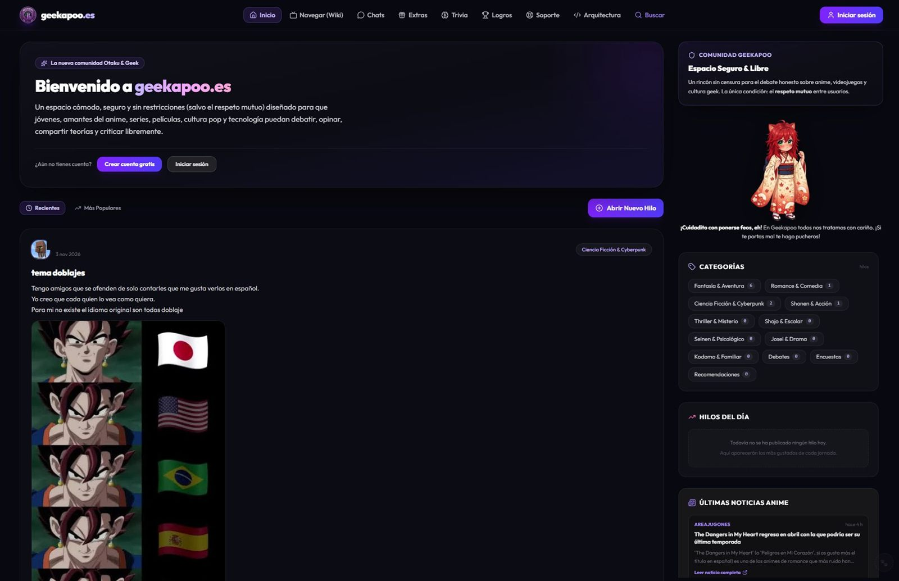
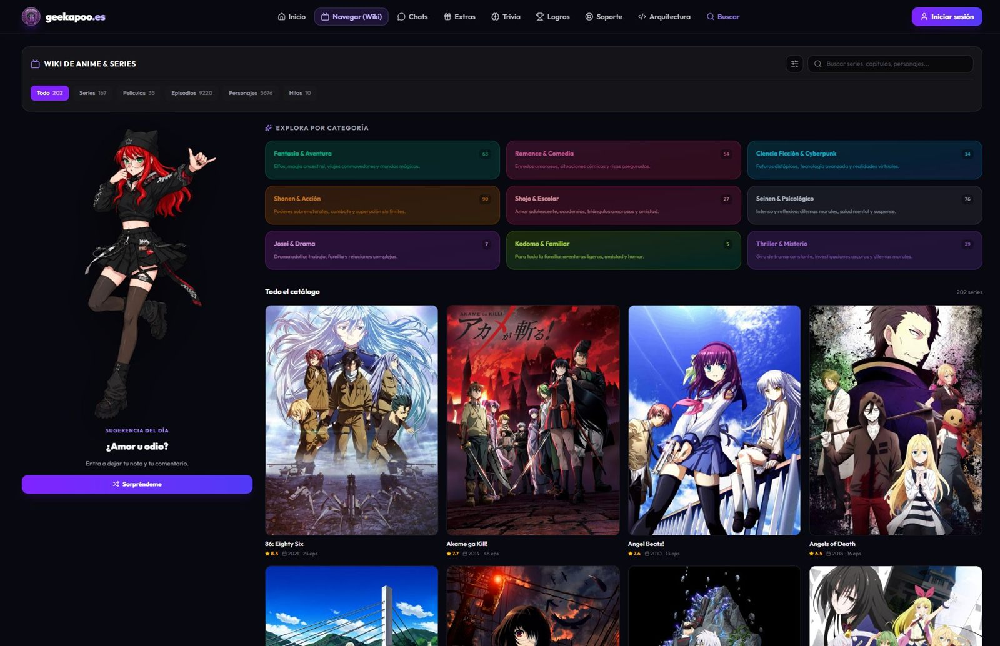
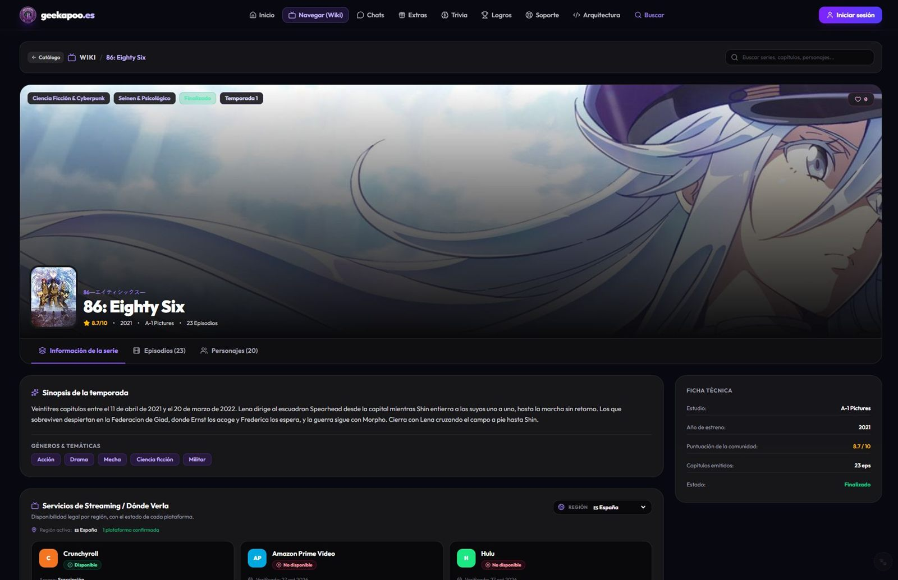
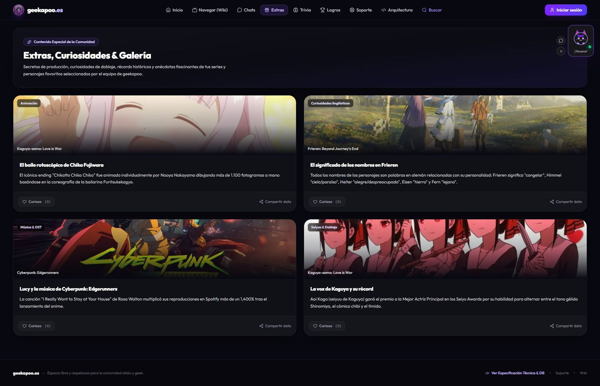

  

<h1 align="center">Geekapoo</h1>

  <b>Comunidad anime, manga y cultura geek en español.</b> 
  Foro · Wiki · Chat · Trivias · Logros

  <a href="https://www.geekapoo.es"><b>🌐 Entrar en geekapoo.es →</b></a>

---

## Una comunidad hecha para quedarse

Geekapoo es una plataforma en español para hablar de anime, manga, series, videojuegos y cultura pop sin ruido. Un foro vivo, una wiki con fichas completas y las herramientas necesarias para que la comunidad se organice sola: chats, perfiles, trivias, logros y curiosidades.

No es una web más con anuncios por todas partes. Es un espacio pensado para que apetezca volver.

  

## ¿Por qué existe Geekapoo?

Buscar «dónde ver X» o «personajes de X» suele acabar en webs llenas de anuncios, datos a medias y enlaces que ya no funcionan. Y los debates de verdad están dispersos entre Discord, Reddit y grupos que desaparecen de un día para otro.

Geekapoo nace para juntar esas tres cosas en un solo sitio:

- **Información cuidada**: sinopsis, temporadas, episodios, personajes, seiyuus y plataformas donde ver cada serie.
- **Conversación real**: hilos, encuestas, reacciones y comentarios, sin que el algoritmo decida qué merece la pena.
- **Comunidad**: perfiles, chats, clubes, trivias y logros para que la gente se quede y se reconozca.

Y con una única regla inquebrantable: **el respeto mutuo**.

## ¿Para quién es?

<table>
  <tr>
    <td width="33%" valign="top">
      <h3>🔎 Para quien busca datos</h3>
      
Quiere saber de qué va una serie, cuántos episodios tiene, quién la anima o dónde verla legalmente. Y quiere encontrarlo rápido, en español y sin ventanas emergentes.

    </td>
    <td width="33%" valign="top">
      <h3>💬 Para quien quiere debatir</h3>
      
Le apetece opinar sobre el último capítulo, defender su opening favorito o montar una encuesta sobre el mejor villano. Sin miedo a que le borren el mensaje por pensar distinto.

    </td>
    <td width="33%" valign="top">
      <h3>🏆 Para quien quiere pertenecer</h3>
      
Disfruta con los logros, las medallas, las trivias y los chats. Quiere un sitio reconocible, con su perfil y su historia dentro de la comunidad.

    </td>
  </tr>
</table>

## Lo que puedes hacer

### 📚 Wiki de anime y series

Más de **200 series**, **9.000 episodios** y **5.600 personajes** con ficha propia: sinopsis, año, estudio, nota de la comunidad, géneros, temporadas, reparto de voces y disponibilidad por región.

  

### 🎬 Fichas que responden a lo que buscas

Cada serie tiene su página con la información ordenada: información de la serie, episodios, personajes y plataformas donde verla. También incluye la nota de la comunidad y los datos técnicos de un vistazo.

  

### 💬 Foro y comunidad

Hilos con categorías y etiquetas, encuestas con caducidad, reacciones con emojis, comentarios anidados y GIFs. Todo pensado para conversaciones que se pueden seguir sin perderse.

### 🏆 Progresión, logros y trivias

Cada acción suma: crear un hilo, comentar, votar, recibir reacciones. El sistema de XP sube del **nivel 1 al 100**, desbloquea medallas y alimenta un perfil que enseña lo que has construido. Las trivias diarias añaden una razón más para entrar cada día.

### 💬 Chats y clubes

Mensajería directa y grupal con un identificador propio (**ChatID**) que permite conectar con otros usuarios sin exponer el correo. Los clubes temáticos agrupan a la gente por intereses: shonen, romance, retro, doblaje.

### 🦊 Kapo-chan, la mascota

Kapo-chan acompaña la navegación, explica secciones y recuerda la norma de la casa: aquí se viene a hablar de lo que te gusta, no a atacar a quien le gusta otra cosa.

### ✨ Extras y curiosidades

Secretos de producción, récords, anécdotas de doblaje y datos que no salen en las sinopsis habituales. La parte de «no sabía que eso era así» de la comunidad.

  

## Galería

<table>
  <tr>
    <td width="50%">
      
      
Wiki: categorías, buscador y catálogo completo

    </td>
    <td width="50%">
      
      
Fichas con episodios, personajes y dónde verla

    </td>
  </tr>
  <tr>
    <td width="50%">
      
      
Inicio: el feed de la comunidad

    </td>
    <td width="50%">
      
      
Extras: curiosidades y secretos de producción

    </td>
  </tr>
</table>

## Filosofía

> **Un espacio libre y respetuoso para la comunidad otaku y geek.**

Eso significa:

- **Respeto por encima de todo.** Se puede criticar una obra; no se puede atacar a una persona por lo que le gusta.
- **Libertad para opinar.** Sin censura innecesaria, sin filtros que decidan por ti. La única línea roja es el respeto.
- **Comunidad en español.** Sin depender de algoritmos, sin que el idioma sea un obstáculo.
- **Datos a la vista.** Si una serie está en una plataforma, se dice; si no, también.
- **Sin ruido.** Ni anuncios invasivos ni ventanas que te persiguen.

## Bajo el capó

<b>Stack técnico y detalles del proyecto</b>

| Capa | Tecnología |
| :--- | :--- |
| Frontend | React, TypeScript, Tailwind CSS, Vite |
| Backend | Firebase Cloud Functions v2 (Node.js / TypeScript) |
| Datos | Firestore en tiempo real |
| Autenticación | Firebase Auth (email/contraseña, Google y GitHub) |
| Almacenamiento | ImgBB y Firebase Storage |
| APIs | TheTVDB, TMDB, GIPHY / Tenor, RSS |
| Hosting | Vercel + Firebase |
| Pruebas | Vitest y `@firebase/rules-unit-testing` |

El catálogo se genera con un índice de búsqueda propio y las fichas de anime se prerenderizan con su título, sinopsis, episodios, personajes y datos estructurados para que Google pueda leerlas sin ejecutar JavaScript.

---

<h2 align="center">¿Entras?</h2>

  <a href="https://www.geekapoo.es"><b>www.geekapoo.es</b></a> 
  Foro, wiki, chat y trivias. Gratis y sin anuncios invasivos.

  <i>Un espacio libre y respetuoso para la comunidad otaku y geek.</i>

---

Nota: <code>geekapoo.com</code> no pertenece a este proyecto. El dominio oficial es <strong>www.geekapoo.es</strong>; <code>geekapoo.vercel.app</code> redirige allí.
